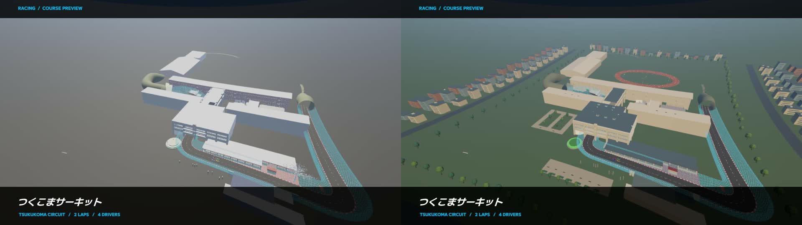

# 校舎の雰囲気改善（2026-10-21）

[改善後の動画（15秒・無音）](Final/campus-intro.mp4) ／ [上空の比較画像（左が以前、右が改善後）](before-after.jpg)

暖色の主光と青みの補助光、校舎の配色、中庭、運動場、並木、周辺の街並みを追加した。白い旧樹木を緑の軽量な植栽に置き換え、校舎前やコースに枝が張り出さない配置にした。F8の **Campus lighting / landscaping / town** で比較できる。

動画は実際のSampleScene・P1カメラを24fps、1280×720で収録した。上空から校舎前への9秒の紹介、3秒のカウントダウン、発進後約3秒を含む。準備画面のみテスト起動で省略し、その後は通常の開始フローを使用。ゲーム時計に沿ったオフライン収録で、描画速度の測定ではない。77bf0a3を基点に今回の変更を適用した作業ツリーで収録した。

以前の画像は `Artifacts/CourseIntro/Final` の同じ経路から取得。約0.6秒と6.9秒のショットを `Before` と `Final` に保存した。`Final/intro-3.jpg` は車載視点へ戻ったところ。

## 確認結果

- 通常再生: `Final/campus-checks.json` が成功。旧樹木5,766,840頂点に対して新景観全体69,688頂点、樹木109本、街の建物156棟。装飾にColliderなし。校舎・道路のCollider状態とMesh参照を保持。
- 紹介中だけ影の範囲50m→650m、解像度2048→4096へ変更し、走行時は50m／2048へ復元。
- F8相当のOFF／ON、雨・夜→元の昼、コンポーネント無効化／再有効化が成功。`Checks/live-switch-weather.json`。
- 両画面の紹介同期、紹介中の時計0・車両の平面移動0、紹介後の全3秒カウントダウンが成功。`Final/course-intro-checks.json`。
- 通常と切り替え試験の走行中の例外0。`Final/report.json` と `Checks/report.json`。発進後3秒／1秒の観測であり、完走タイムの評価ではない。
- 既定ONの追加も含め、コアの単体テスト108件成功、失敗0。`core-tests.xml`。

実装・衝突判定・再実行方法は [実装メモ](../../Documentation/CampusAtmosphere.md) を参照。
