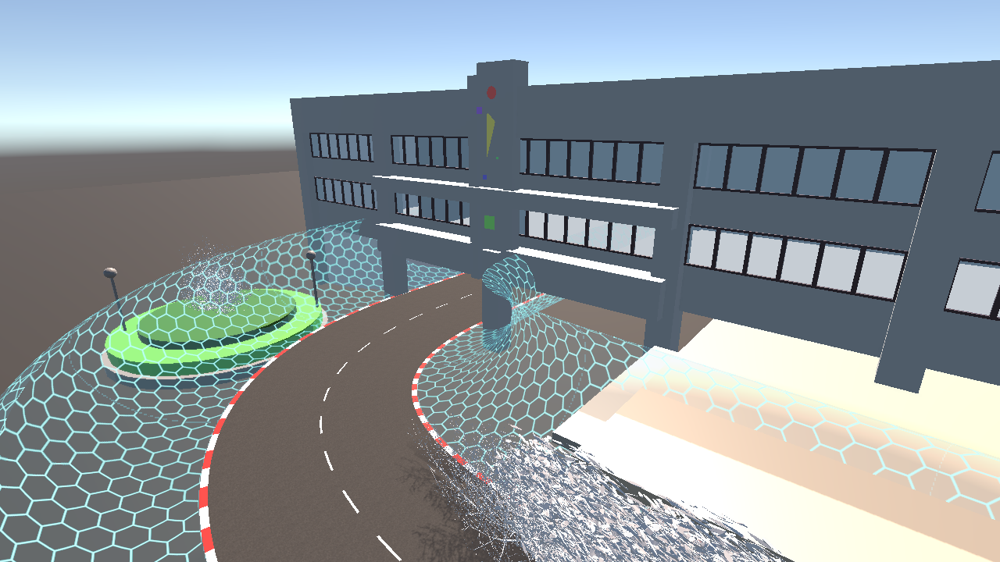
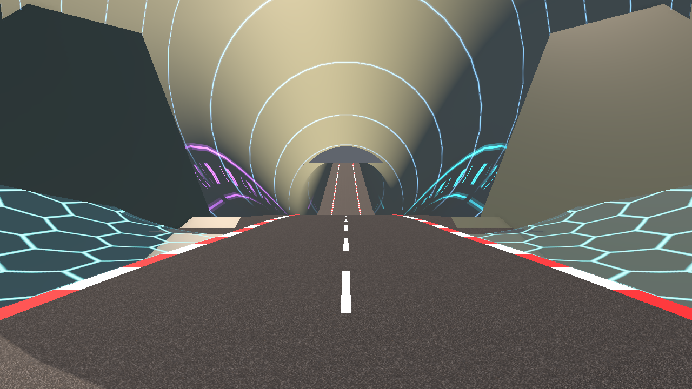

# 青いバリアの全線配置と2周レース

2026-10-16、日本時間。Unity 6000.3.9f1 / Apple M1。

## 変更

- SampleSceneのチューブ外全線の左右に、既存の青い六角格子バリアを配置。下部の円弧と上部のかえし、厚み付きの衝突面も既存と共通。
- 道路と同じ境界・高さから自動生成し、幅や線形の編集に追従する。ジャンプ区間も両脇にバリアをつなぐ。旧コースの手置きバリアは無効化。
- チューブの内壁・天井を実際に照会して、内部を除外。入口・出口までバリアをつなぐ。
- 通常の終了周回数を2周へ変更。タイトル・カウントダウン・HUDと最終周BGMも同じ設定を参照する。2周目に最終周BGMへ切り替わる。

## 検証

[coverage.json](coverage.json) と [validation.txt](validation.txt) に結果を保存した。

| 確認 | 結果 |
|---|---|
| チューブ外の道路両側（0.5m間隔、1,638地点、約819m） | 衝突面の欠落0 |
| チューブ内（2,021地点、約1.01km） | 内部のバリア基部0 |
| 再生成 | 古い衝突メッシュを解放、壁の重複なし |
| 左右それぞれ地上・空中から横方向25m/sで衝突 | 車両大の剛体4条件すべて落下なし |
| 既存のバリア・道路・コース・チューブの形状検証 | 成功 |
| 2周目の最終周BGM、視点別BGM・リトライ | 成功 |

実モデルを読み込んだSampleSceneで、ペダル・ハンドルだけの実車試走を2回実施した。時間倍率3、固定物理刻み約0.02秒、通常の360秒上限・先着後40秒のルールを使用。

| 試走 | P1 | P2 | 手動復帰 |
|---|---|---|---:|
| 通常走行、アイテムなし | 2周完走 約190.4秒 | 2周完走 約182.9秒 | 0 |
| アイテムあり | 2周完走 約193.0秒 | 2周完走 約182.5秒 | 0 |

アイテムありでは、P1が19.62秒にシールド被弾し、21.94秒に `WallCollider` との接触を記録。22.10〜23.56秒の約1.46秒間はコース判定外だったが、高さ約16〜17mを保ち、復帰入力なしで走路へ戻って2周を完走した。CPU2もこの回で2周完走した。

試走記録は [Playtest/report.json](Playtest/report.json)、[集計CSV](Playtest/summary.csv)、[進捗グラフ](Playtest/progress.svg)。各試走フォルダに入力・位置・速度・周回・順位のCSVと、接触・被弾・逸脱のイベントCSVがある。計14,349行の走行データの整合性を確認し、捕捉したゲーム実行時エラーは0件だった。

これは自動運転による今回の条件での確認で、任意の入力・速度での落下が起きないことの証明ではない。バリアの外側へ乗り上げる間は、落下せずにコース判定外となる場合がある。

## 確認画像

[スタート周辺](start-barriers.png)／[坂・ジャンプ周辺](jump-barriers.png)／[チューブ入口](tube-portal.png)／[チューブ内部](tube-interior.png)。実シーンを編集用の確認カメラで撮影した画像で、車両の走行画面ではない。





## 再実行

Git LFSの実データを展開したプロジェクトで実行する。

```sh
Unity -batchmode -projectPath <project> -executeMethod CourseBarrierValidation.Run -quit
```

Editorメニューは `Racing > Validate Course Edge Barriers And Two Laps`。画像だけ撮り直す場合は `Racing > Capture Course Edge Barriers`。

試走はリポジトリのルートから以下を実行する。

```sh
RACING_BALANCE_OUTPUT="$PWD/Artifacts/CourseSafety/Playtest" \
RACING_BALANCE_TIME_SCALE=3 \
RACING_BALANCE_RUN=equal-control-101,items-402 Tools/RunBalancePlaytest.sh
```

## 前回の記録の訂正

前回の `Artifacts/BalancePlaytest/` の試走時は、作業用コピーのコースFBXなどがGit LFSの参照ファイルのままで、元モデルの地面・チューブが読み込まれていなかった。特に長時間落下の記録には、その環境の影響を含む。前回レポートの冒頭に訂正を追記した。

今回はローカルの実ファイルを復元し、SHA-256がGit LFSの参照と一致することを照合した。コースモデルやフォントの内容を変更したわけではない。チューブの4,305頂点の保持・地面との干渉も検証した。前回との差をバリアだけによる改善率として扱わない。
