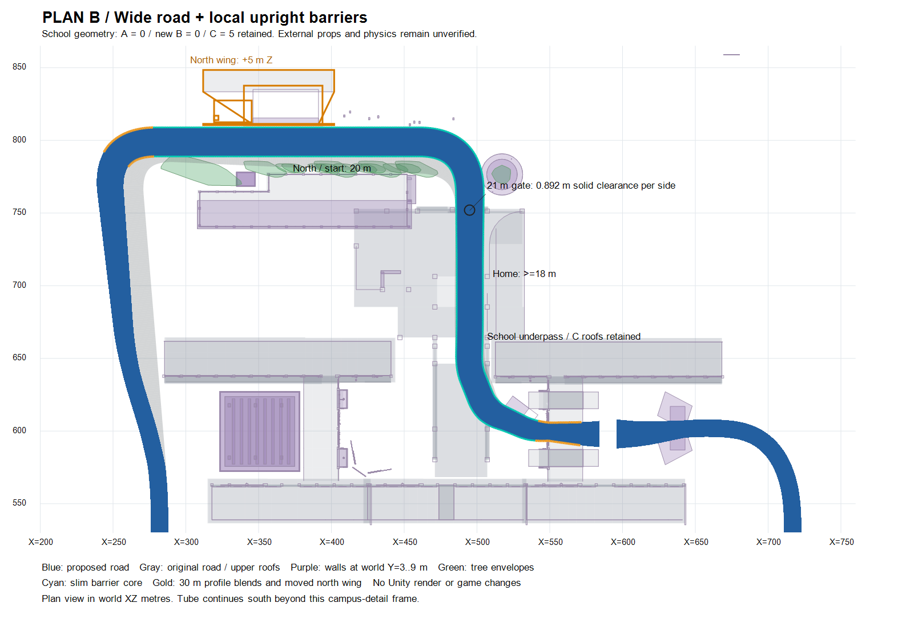
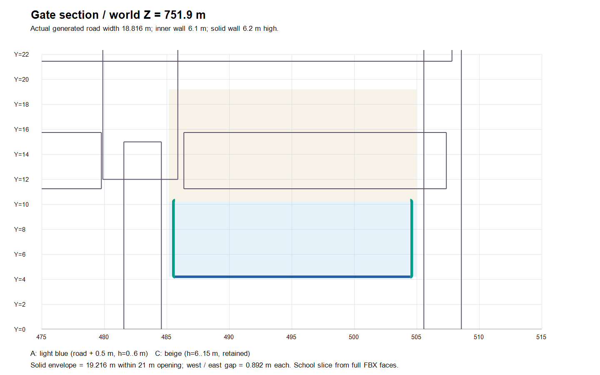
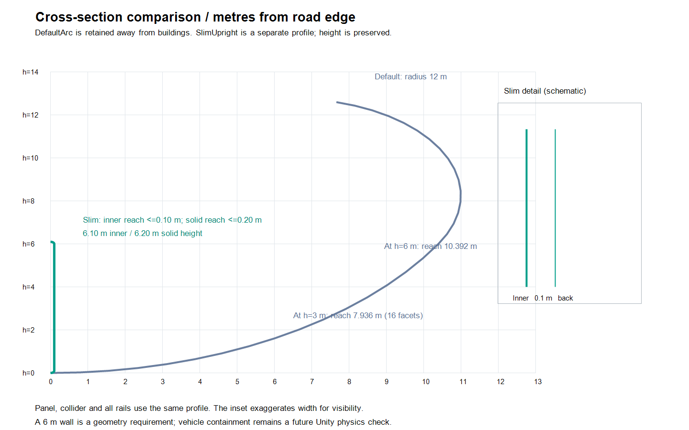
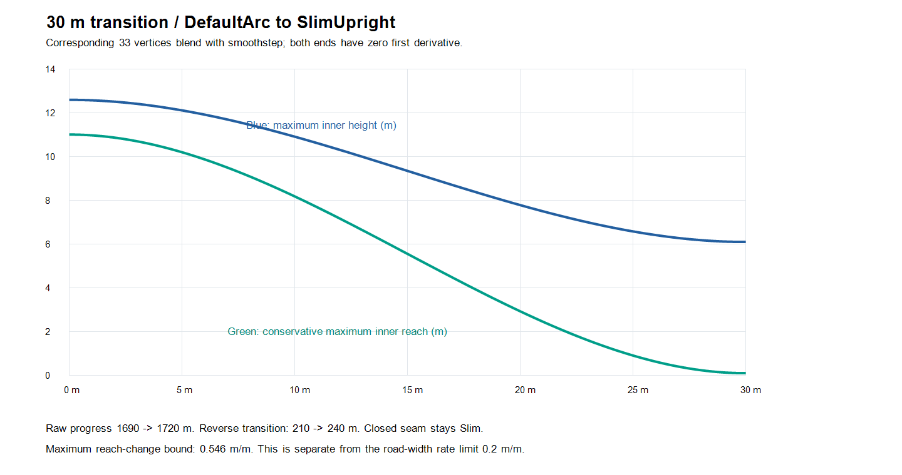

# Plan B：建物近傍だけ細い立ち壁にする配置設計

**推奨：前任の道幅12m案に代えて、この案を次の実装検討に使う。ゲームへの即時適用は保留する。**

校舎モデル550物体を対象とするオフライン計算では **A=0物体、新断面のB(0〜6m)=0物体**。ホームは18m以上、北側／スタート直線は20mを保つ。北側棟1グループをZへ5m移動し、木は動かさない。新しい壁と切替部の金物・Colliderを含む外接領域も、校舎との交差0。線形の数値条件は通常1.5m・細分化0.25mの両方で合格した。

ただし、校舎外の行灯・ゲート等と移動棟の0.3m以上の隙間は未確認。Unityでの壁の生成・走行・衝突も行っていない。したがって、**配置設計の校舎範囲での合格であり、全シーンへの適用承認・物理的な乗り越え防止の証明ではない**。状態は `offline_geometry_verified_pending_physics_and_external_scene_clearance`。

元指示書 `C:/Users/tsuka/.claude/codex-lead/jobs/20261021-1718-Racing-playability-audit/D1/prompt.md` と前任の `../README.md` を読んで設計した。本フォルダーのみに書き込んだ。ゲームファイルの変更、Unity起動、git commit/push/ブランチ変更はしていない。既存の作業ツリーの変更はそのまま残している。

## 前任案との比較

| 項目 | 前任：道幅を削る案（未達） | Plan B：局所的な細い立ち壁 |
|---|---|---|
| ホームの幅 | 12m | 最低18m、北端へ20mに回復。北端柱位置の生成後幅18.816m |
| 北側／スタート直線 | 12m | 20m。ホーム側のスタート位置も18m以上 |
| その他の幅 | 北側・入口・ホームを縮小 | 元の幅を優先。西側は12mへ徐々に絞りチューブ12mに接続、着地後に幅17.95mの補助点 |
| 踏切／着地／チューブ | 制御点・幅・フラグを保持 | 同じく保持。チューブ直前38.187mの元の直線も保持 |
| バリア | 既定断面ではB低帯に柱1物体が残る。高さ1.1m案は全高約2.31mで条件外 | Slim内面高さ6.1m・裏面込み6.2m、内面張出し0.1m・全金物込み0.2m |
| 変更する区間 | 22.5〜188 / 1738.887〜1914mに参考値のみ。接続未確定 | 新progress 0〜210 / 1720〜1939.674mがSlim。210〜240 / 1690〜1720mを30mかけて接続 |
| 建物 | 北側棟1グループ・6 Renderer、Z+10m | 同じ1グループ・6 Renderer、Z+5m。上限10m以内 |
| 木 | 0本 | 0本。向き・間隔は不変 |
| 侵入の残り | A=0、既定B(0〜3m)=1、既定B(0〜6m)=24物体、C=4物体 | A=0、新B(0〜6m)=0、変更壁の全高外接領域=0、C=5物体（一覧は下記） |
| 走りやすさ | 12mに狭まり、低い壁の参考案は保護高さ不足 | 18〜20mを確保。壁接触は垂直衝突に近づき、円弧を登る逃げ場は減る。切替の押し返しは要実走確認 |
| 見た目 | 校舎の大移動は回避できるが狭い。低い壁案は不採用 | 棟移動は5mに抑制。高さ6mの壁が近くなるため閉塞感が出る。青い材質と丸い足元・上端を継承 |
| 実装の手間 | 配置変更だけでは完了しない。区間値の生成対応も未実装 | 断面の種類、全周progressの伝達、33点の補間、金物・Collider・壁走行域・検証の対応が必要。単なるパラメーター変更より大きい |
| 推奨 | 採用しない | 設計検討の主案。全シーン隙間と物理検証を終えるまで適用は保留 |

前任の「完全案」が全世界で不可能だったという比較ではない。21mの既存開口と既定断面の組み合わせでは通過できなかった、という局所的な結論を引き継ぐ。

## 21mの柱間を通せる理由

北端 `1016こうしゃ/Cube.047/Plane.019` の同一メッシュ内の柱は、西側の内面X=484.5568、東側X=505.5568、内法21m。Zは約749.914〜753.814m。部品の分離・編集は行わない。

既定半径12mの円弧は高さ3mで7.937m（16分割面では7.936m）張り出す。道路12mでも必要幅27.871mとなり、前任案は収まらなかった。道路20mにAの左右0.5mを足すだけでも21mになり、数値誤差を含めた余裕がない。したがって、柱列があるホームでは最低許容幅18mを選ぶ。全区間20m維持とは報告しない。

Plan B のZ=751.9mの実線形での値は以下。道路断面はこの位置ではZ軸に平行なので、開口面の幅と直交断面幅が一致する。

| 指標 | 値 |
|---|---:|
| 中心X / 路面Y | 495.0568 / 4.211394m |
| raw progress | 1899.135957m |
| 生成後の道路全幅 | 18.815965m |
| 内面まで含む幅 | 19.015965m |
| 裏面・金物まで含む幅 | 19.215965m |
| 西柱／東柱との実体外接領域の隙間 | 各0.892018m |
| Aの左右0.5mまで含む幅 | 19.815965m |

これはZ=751.9mでの断面値。柱のZ厚全体と他の柱についてのA/B判定は、全コースの面クリッピングで別途行った。狭い一点だけを調べて全体合格とはしていない。





## 移動と自然さ・地面

`moves.json` は「物体パス → [dx,dz]」のワールドメートル。元配置からの絶対変位であり、繰り返し加算しない。

| 単位 | dx | dz | 最大移動 | 理由 |
|---|---:|---:|---:|---|
| `1016こうしゃ/Cube.008` と全ての子 | 0 | +5m | 5m | 北側の20m道路と棟の南面の余地を確保 |

対象Rendererは Cube.008 とその子 Cube.009 / Cube.010 / Plane.001 / Plane.002 / Plane.003。壁・柱・屋根・窓を一緒に動かし、内部相対変位0m、Y変位0m、回転・縮尺も不変。親Transformへ一度だけ適用する設計。ほかの棟は動かさない。並木は全て元の配置を保つ。北側棟との通路方向の間隔は5m増える。

移動後の6 Rendererと、動かさない学校モデルの全物体との3D AABB距離の下限は **6.484382m ≥0.3m**。最接近の組は `Cube.008/Cube.009` と `人間.007`。AABB同士の離隔は実表面の離隔の下限なので、この値が0.3m以上なら学校内の隙間を保証できる。内部の壁・屋根の接続と支持地面は別物体の隙間判定から除外した。

6 Rendererそれぞれの新旧XZ外接矩形が、`1016こうしゃ/Plane` の**穴を除いた実支持ポリゴン内**に収まることを確認した。凹形境界を含み、矩形の4隅だけでなく境界の横断も検査した。支持面の傾きによる新旧高さ差の最大は **0.0000003775m**、許容0.001m以下。支持高さの各Renderer別範囲は `verification.json` に収録。元からある建物足元の微小誤差を新たに補正せず、浮沈が増えない設計としている。

**学校外の小物については、上記の6.484mを流用しない。** 入力に全シーンの実形状がないため、その0.3m条件は未解決。

## コースの変更と検証

`course.json` の `authored_table` が SchoolMapCourseSetup の手入力用制御点と全幅。`waypoints` はチューブを含む137点を全て収録。元の制御点indexは追加点によって変わるため、旧indexのまま置換しない。

主な変更：

- 北東点を (495.0568,6,799)、北西点を (245,1,799)、北側全幅20m。
- 西側の (260,3,640) と (278.142854,4.682943,595) を幅12mで追加し、元のチューブ直前直線へ戻す。
- 着地後の元の直線上に (607.5,12,598)、全幅17.95mの幅制御点を追加する。
- 踏切接近の2点を (549,17.7,599.6) / (536,15.5,600.45) に微調整する。
- ホーム導入点を (493,3,619)、直線の2点を (495.0568,3,650) / (495.0568,3,720)、幅18mにする。北端に向けて20mへ回復する。
- その他の既存幅は元表を保持する。踏切 (584,18,598) 幅18m、着地 (596,16,598) 幅20m、jumpフラグは不変。

| 指標 | 通常1.5m | 細分化0.25m | 合格条件 |
|---|---:|---:|---|
| 全長m | 1939.674147 | 1939.693909 | 元1908.334561mの±3% |
| 全長変化% | +1.642248 | +1.643284 | ±3 |
| 踏切前40mの方位変化° | 5.550412 | 5.894718 | ≤6 |
| 接近路の最小半径m | 32.264819 | 30.360555 | ≥30 |
| 全幅変化率m/m | 0.187832 | 0.199608 | ≤0.2 |
| 最小幅m | 12 | 12 | ≥12（ホームは別途≥18） |
| 踏切方向±0.5°の直前整列長m | 6.683584 | 6.575865 | ≥6 |
| 道路面の折り返し三角形 | 0 | 0 | 0 |

最小半径・幅変化率の余裕は大きくない。将来の実装で制御点・丸め・サンプリングを変更した場合は、同じ数値をそのまま適用しない。踏切直後は空中区間なので接近路曲率の計算対象外だが、踏切軸との整列は別に確認している。

チューブ121点の位置・幅・フラグは完全一致。元の直前直線を38.186609m残すので、丸め窓がチューブ内から外の新しい屈曲点を見ない。同じsource distanceで0.25mサンプルを比較した最大差は0.004329mで、全長変更による再サンプル・補間差を含む。サンプル配列がビット単位で同じという主張ではない。生成済みUnityメッシュの一致は未検証。

## バリア区間と侵入判定

`barrier-sections.json` は新コースの **raw progress [m]**。レース進行方向とは逆で、前任案のprogressとは一致しない。

| progress m | 断面 |
|---|---|
| 0〜210 | SlimUpright |
| 210〜240 | 30mかけて Slim→DefaultArc |
| 240〜1690 | 既定円弧 |
| 1690〜1720 | 30mかけて DefaultArc→Slim |
| 1720〜1939.674147 | SlimUpright。閉路の0mへ同じ断面で接続 |

Slim は足元半径0.1mの丸み＋高さ6mの垂直面＋半径0.1mの上端丸み。内面高さ6.1m、裏面込み6.2m、内面最大張り出し0.1m。厚さ0.1mのColliderと専用の金物を合わせた最大張り出し0.2m。既存の厚さ0.6m・金物寸法をそのまま使う案ではない。断面の具体式、コードの対象箇所、走行判定への影響は [barrier-code-plan.md](barrier-code-plan.md) を参照。





検証は0.5m以下の区間に分割し、通常の元サンプルの接続も全て含め、5mm＋道路miterの外接誤差を加えて面をクリップした。非木は全FBX面を使い、既存の床3箇所だけ実OBJの切抜き後面を使う。木は全FBX bounds・凸包でまず除外し、必要なものはOBJの高さ0.5mごとの保守的外形で調べた。旧OBJの近傍物体一覧だけで新しい経路を合格にはしていない。

Aは走路＋端0.5m、路面上0〜6m。Slim Bは道路端から内面までを外接する0.1m幅、0〜6m。切替部Bは区間全体の最小Slim重みaで `11.01(1−a)+0.1a` の幅を使い、補間途中の全頂点・全高さを包む。両端だけの確認ではない。変更壁の **全高・裏面・金物を含む外接領域**も、幅 `11.61(1−a)+0.2a`、高さ `13.2(1−a)+6.2a` の保守的帯で校舎との交差0を確認した。これは材質の見え方や物理挙動の確認ではない。

新Bを狭めること自体が今回許された仕様変更である。既定Bの0〜3mが空いた、と読み替えてはいない。細い壁の区間でもAの0〜6mは維持しており、壁高を下げて侵入を消したものではない。

## 残すC：5物体

校舎下を通る設計のため、走路上6〜15mのCは残す。幅が前任の12mから広がったことにより Cube.047 も新たにCに含まれる。区間は新raw progress。

| 物体（`1016こうしゃ/` 以下） | progress m |
|---|---|
| Cube.047 | 1897.0000〜1900.5000 |
| Cube.047/Cube.090 | 1898.2907〜1899.0000 |
| Cube.047/Plane.010 | 1898.5000〜1899.0000 |
| Cube.047/Plane.019 | 1752.0000〜1786.0000、1799.0000〜1902.0000 |
| Cube.047/Plane.051 | 1898.5000〜1899.0000 |

境界の保守的な区間分割・ガードを含む値。正本は `remaining-C.json`。

## 再現と残る判断

リポジトリルートで実行する。インストール不要、Unityは起動しない。

```powershell
$env:PYTHONDONTWRITEBYTECODE='1'
$env:PYTHONIOENCODING='utf-8'
& 'C:/msys64/clangarm64/bin/python.exe' Artifacts/CourseVisualAudit/design/planB/design.py --export
& Artifacts/CourseVisualAudit/design/planB/render.ps1
```

入力のSHA-256は前任の検証時と全9ファイルで一致し、今回の計算中も変化しなかった。結果は `verification.json`。`design.py` は前任の読み取り・丸め・面クリッピング関数を再利用し、出力だけをこのフォルダーへ書く。`gate-slice.json` は Z=751.9m で全FBX面を交差させた断面線で、図の入力として同梱する。

残る判断（`unresolved`）：

- 校舎外の行灯・ゲート・その他生成物も含む、移動棟との0.3m以上の隙間。今回の全校舎550物体の合格と分けて扱う。
- 新断面のメッシュ生成、閉じたCollider、金物の外接寸法、左右のcoverage、切替部／閉路の継目、実車の壁走行・張り付き復帰・乗り越え防止。今回はコードを実装せずUnityも使わないため保留。
- 通常・0.25mのオフライン線形は合格だが、実装時のfloat精度と生成メッシュを再確認する。course変更に伴うスタート・チェックポイント・ゴール・アイテム等の追従も実装工程で必要。

これらはゲーム変更の追加許可を求めるものではない。本タスクでは設計資料まで作成し、ゲームへの反映は行わない。
