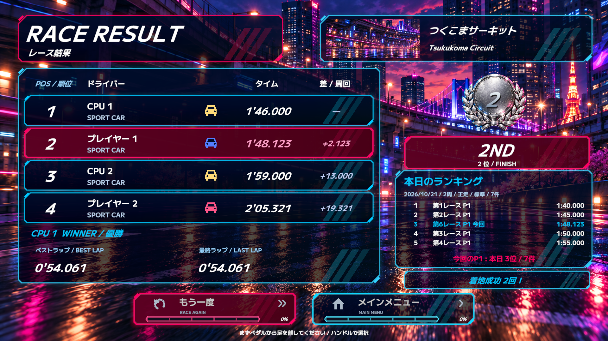

# 本日のランキング検証（2026-10-21）

機能本体: `80d0fc9`、Unity 6000.3.9f1。

- [Coreテスト](core-test-results.xml): 125件全通過。順位・ミリ秒境界・同順位・重複・再プレイ・日付／コース別・CPU／DNF／自動運転／無効タイムの除外・上位外の本人順位。
- [保存・UI検証](validation.txt): 一時フォルダに実際のJSONを書き、再起動・日付変更・P1/P2・周回違い・Constant pedal相当の除外・バックアップ復旧・両ファイル破損時の元データ保持・書き込み失敗を確認。
- 結果画面を720p／1080p、P1／P2別に描画し、日本語グリフ・F8切り替え・上位外の自分の順位・未完走／自動運転／保存エラー表示を検証。

## 表示例（架空のタイム）



[P1 720p](result-p1-1280.png) / [P2 720p](result-p2-1280.png) / [P2 1080p](result-p2-1920.png)。架空の過去5レースと今回2人の結果を表示するテスト。今回P1は本日3位、P2は上位5件に入らない本日7位。

## 実コースの統合試験

[統合検証](course/daily-integration.txt) / [試走レポート](course/report.json) / [結果](course/summary.json) / [保存されたランキング](course/saved-ranking.json)。

`human-fast-control-7102`、実際のSampleScene・本番車Prefab・2周。コース・車体状態・前方車を観察し、0.18／0.22秒の反応間隔、物理ハンドル換算360度/秒までの操舵入力とペダルで走る人間相当のボットを使用。完走・チェックポイント・車体位置・速度を書き換えて結果を作らない。通常の復帰操作は許可される計画で、P2はリセット1回を使用した。

| 車両 | 実際の完走タイム | 本日への登録 |
| --- | ---: | --- |
| P1 | 1:49.012 | 1位・109012 ms |
| P2 | 2:31.012 | 2位・151012 ms |
| CPU 1 | 2:07.012 | 対象外 |
| CPU 2 | 1:46.012 | 対象外 |

ゲーム実行中の例外0。自然な完走通知で2件だけ保存され、P1/P2の両結果画面に同じランキングが渡ること、重複通知で増えないこと、別インスタンスから同じ履歴を再読み込みできることを確認した。通常の自動バッチは記録対象外。この統合試験に限りEditor専用プローブで `Logs/DailyRanking/Course/history-*` の専用履歴を使い、本番の履歴とネットワークへの公開を避けている。

```sh
bash Tools/Validate-Rgp.sh
Unity -batchmode -projectPath "$PWD" -executeMethod DailyRankingValidation.Run -quit -logFile /tmp/daily-ranking.log

RACING_BALANCE_SKILL_SUITE=1 RACING_BALANCE_RUN=human-fast-control-7102 \
RACING_BALANCE_TIME_SCALE=6 RACING_BALANCE_OUTPUT=Logs/DailyRanking/Course \
RACING_DAILY_RANKING_CHECK=1 RACING_DAILY_PLAYTEST_OUTPUT=Logs/DailyRanking/Course \
Unity -batchmode -projectPath "$PWD" -executeMethod SteeringComfortValidation.RunCourseBatch \
  -logFile /tmp/daily-ranking-course.log
```
