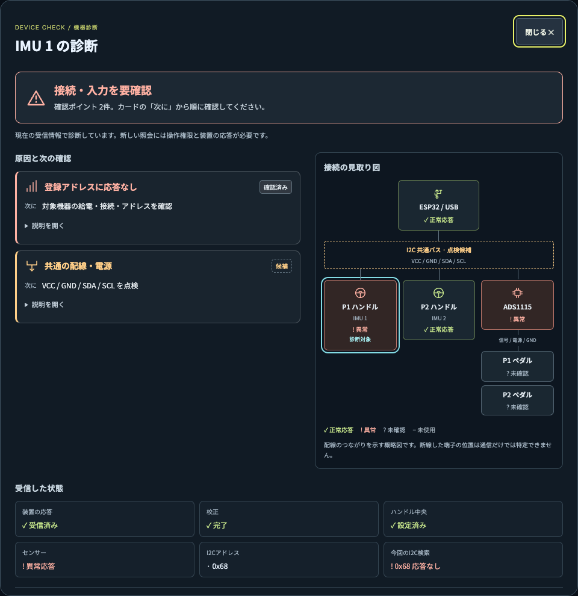
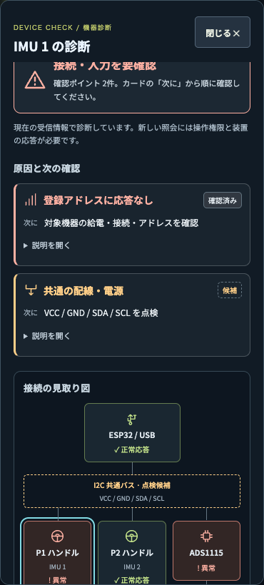
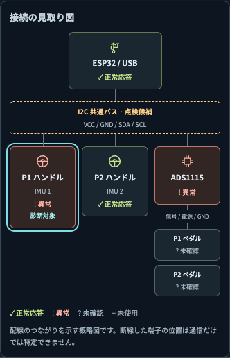

# 機器診断の表示改善（2026-10-23）

長い箇条書きから、アイコン付きの原因カード・短い次の確認・接続の見取り図へ変更。

- 赤は異常応答、黄色は準備不足や点検候補。色に加えて記号・文字を表示。
- 「確認済み」と破線の「候補」を区別し、配線不良を断定しない。
- 詳細説明・生の状態情報・長い点検手順は展開して読む。
- 図はESP32 → 共通バス → IMU / ADS1115 → ペダルの関係を表示。水色の枠は診断対象。
- USB断・古い応答・Unity切断では過去の異常色を使わない。未使用の機器は灰色。
- 入力がないプレイヤーや正常範囲外のペダルを正常色で表示しない。
- スマホは1列表示。スクロール中も見出し・閉じるボタンを保持。

## 表示例

以下は再現用データによる画面例で、実機でこの障害が発生していることを意味しない。
IMU 1とADS1115の異常、登録アドレスへの無応答、共通配線の点検候補を表示。

## 検証

`RACING_BROWSER_TEST=1 NODE_PATH=<Playwrightを含むnode_modules> node --test Tests~/Dashboard/*.test.cjs`

56テスト成功。実際のHTML/CSS/JavaScriptをChromeで描画し、8シナリオ × 4サイズ（1440×1100、390×844、320×700、844×390）を確認。共通バス異常、校正・基準未設定、USB未接続、古い応答、Unity未接続、未使用機器、入力配信停止、正常な0入力を検証。横はみ出しなし、説明の開閉・更新後の展開維持、閉じる・Escape、接続断時の表示クリア、閲覧中に機器操作を送らないことも確認。

稼働中の8765/8766を使用せず、一時コピーで19765/19766に置き換えてDashboardRelay統合テストも実施。ビルド、プッシュ通知31検査、入力ハーネス、起動・認証・設定・通信とPC/スマホの診断ボタン操作が成功。初回の大量通信履歴の欠落検査で待ち時間超過があったため、最終資産でproduction bridge統合グループを再実行し18成功・失敗0（PTY実機検査1件は未実行）。

ESP32の物理配線故障を発生させる検証、iPhone実機での表示確認は未実施。実機からの既存の状態照会・校正・走行中の検索制限は維持。
