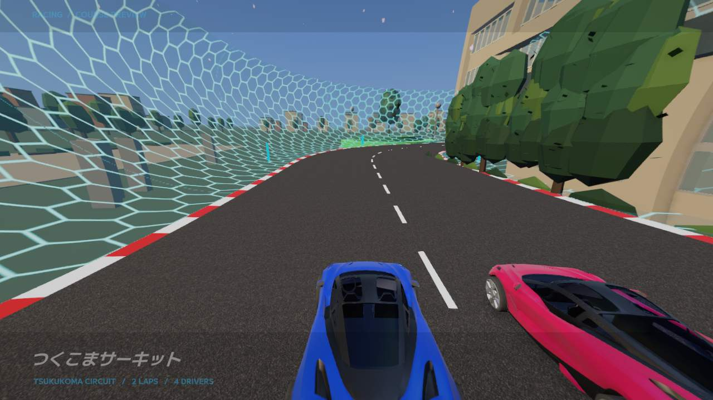

# スタート横の鬱蒼とした木立（2026-10-21）



[発進前から走行までの動画（8.5秒・無音）](Final/start-grove.mp4) ／ [復活前](Before/start-grid.jpg)

以前の15本の樹木の位置を生かし、スタート横の鬱蒼とした木立を再構成した。先細りの幹と枝、3層の不揃いな葉の塊、細かい葉、下草を重ね、深緑から明るい緑までの色差を付ける。校舎前の狭い植栽帯へ幹・低木を収め、上の枝葉だけが茂る配置にした。初回の実画面確認で校舎・舗装との重なりを調整し、最終画像で確認した。

旧FBXの白い重い木を再表示するのではなく、景観用の共有メッシュへ追加した。今回の木立・低木は57,776頂点、景観全体127,464頂点・124本・1 MeshRenderer・16 Material。元の旧樹木の描画頂点数合計は5,766,840。描画対象のメッシュ量の比較で、FPS計測ではない。Colliderを追加せず、F8の **Campus lighting / landscaping / town** に含めて切り替わる。

実際のSampleScene、P1カメラを24fps・1280×720で収録した。動画は紹介の終盤から3秒カウントダウン、発進後約5秒まで。準備画面だけをテスト起動で省略し、走行には通常の入力ゲートを通す既存の人間に近いハンドル・ペダル入力ボットを使用。a0d3092を基点に今回の変更を適用した作業ツリーで収録した。

確認結果は `Final/campus-checks.json`、`Final/course-intro-checks.json`、`Final/report.json`。追加装飾にColliderなし、校舎・道路のCollider保持、紹介終了後の影設定復元、両画面の紹介同期、紹介中の時計・車両位置保持、発進後5秒の走行中例外0を確認した。完走試験ではない。新しい木立に既存の景観スイッチを適用する構造で、今回の撮影は通常ON状態。

再実行:

```sh
RACING_BALANCE_SKILL_SUITE=1 RACING_BALANCE_RUN=human-fast-control-7102 \
RACING_BALANCE_TIME_SCALE=1 RACING_BALANCE_VIDEO=1 RACING_BALANCE_WINDOW_SECONDS=5 \
RACING_COURSE_INTRO_CHECK=1 RACING_CAMPUS_ATMOSPHERE_CHECK=1 \
RACING_BALANCE_OUTPUT=Logs/StartGrove/Verified bash Tools/RunBalancePlaytest.sh
```
