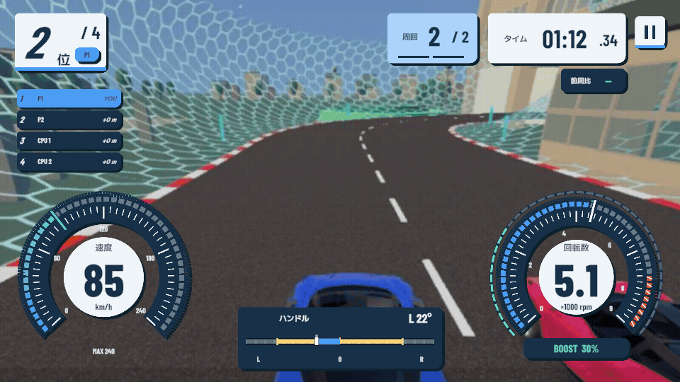
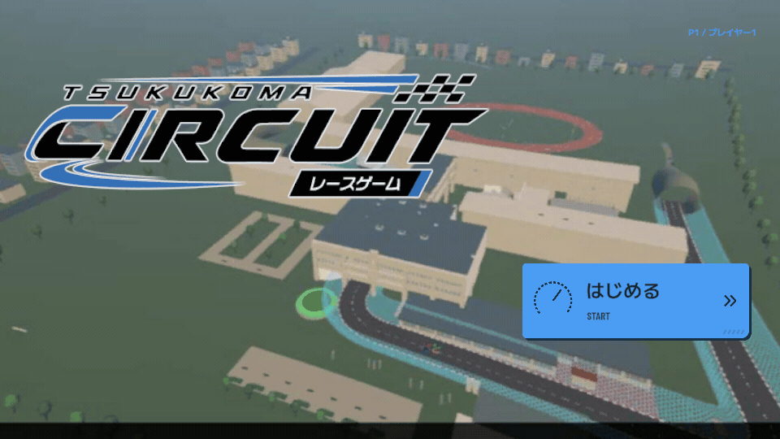
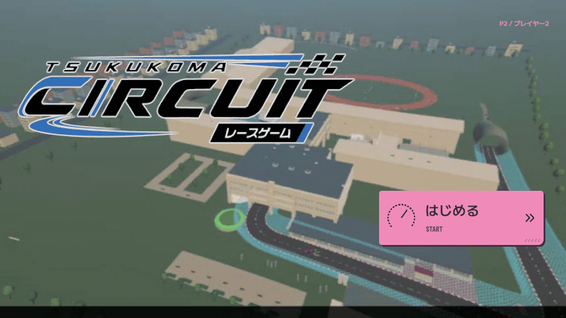
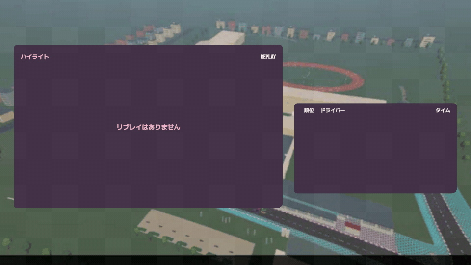

# UIモーションのプレビューと検証

Unity 6000.3.9f1 / `codex/ui-motion`。

## モーションプレビュー

製品用のUIコンポーネントを固定時間で進めて撮影したプレビュー（960×540、25fps）。別実装のデザイン画像ではない。背景と走行値は撮影用の固定素材・サンプル値で、実レース録画ではない。リザルトのプレビューはリプレイ未接続のfixtureを使用する。

| 対象 | 見どころ |
| --- | --- |
| [青HUD](hud-blue.gif) | 加速→ブースト反応と順位上昇→減速と順位下降。走路中央は空けたまま。 |
| [斜めシャッター](transition-blue.gif) | タイトルからレースHUDへ、5本の帯が時間差で横断。 |
| [ピンクのボタン](buttons-pink.gif) | フォーカス、短い長押しの取消、再度の長押し、確定。 |
| [ピンクのリザルト](result-pink.gif) | 本人の順位・タイム→順位表を時間差で表示。リプレイ領域は固定。 |

## 実レースの画面

`../ArcadeSportUI/Live/` はSampleSceneのPlay Mode検証から取得する。特に `race-p1.png`、`item-p1.png`、`spectator-p1.png`、`result-p1.png` は実際の車両・HUD・アイテムイベント・リプレイを通した表示。検証用のゴール・DNF操作を含み、通常プレイのレース記録ではない。

## 再生成

1. Unityに `-batchmode -projectPath <repo> -executeMethod UIMotionCapture.Run -quit` を渡す。
2. `/private/tmp/racing-ui-motion/<clip>/frame-%03d.png` が生成される。
3. ffmpegの`palettegen`/`paletteuse`で25fps、loop=0のGIFに変換する。代表フレームは `stills/` に出力される。

## 検証範囲

実行結果は [verification.json](verification.json)、演出と検証コマンドの対応は [Documentation/UIMotion.md](../../Documentation/UIMotion.md) を参照。

対象部品のウォームアップ後のGC割当を検査している。ゲーム全体のGCや実機フレームレートを測定した値ではない。キーボード／注入入力による自動検証のため、実筐体のペダルと複数ディスプレイでの最終体感確認は残る。
