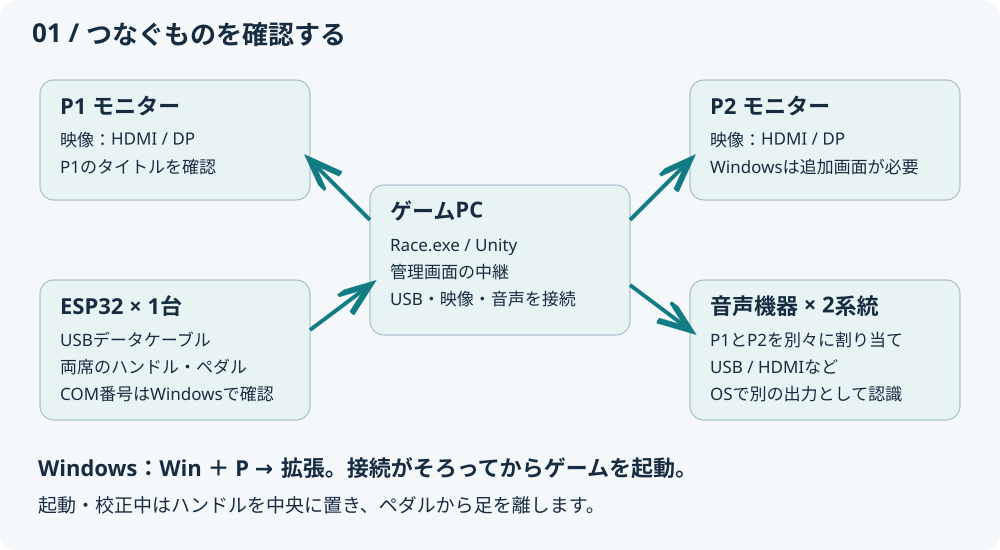
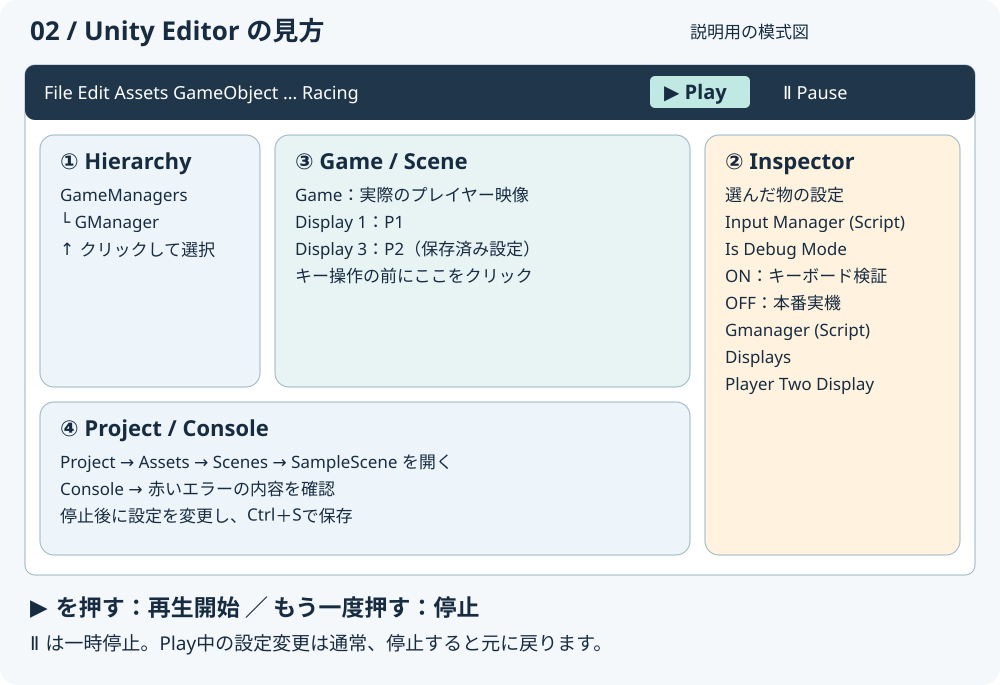
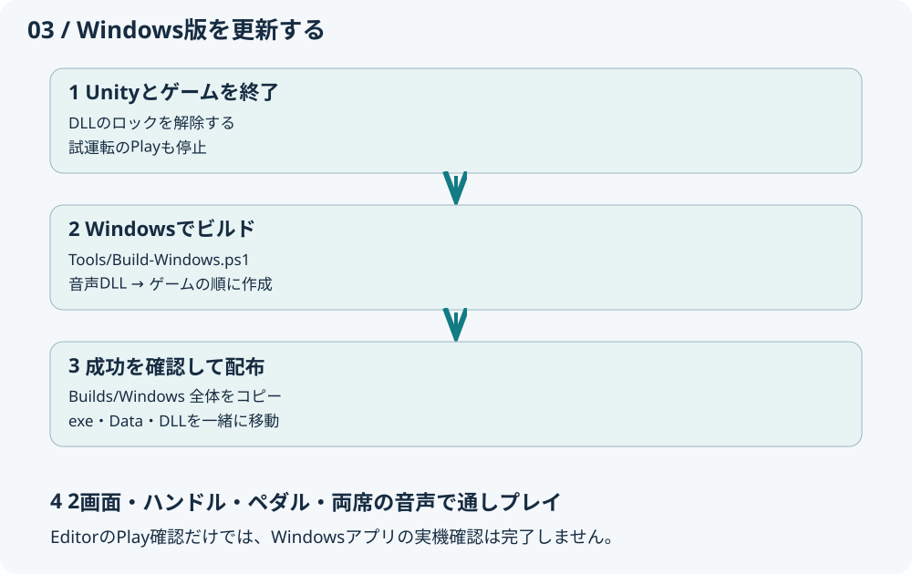
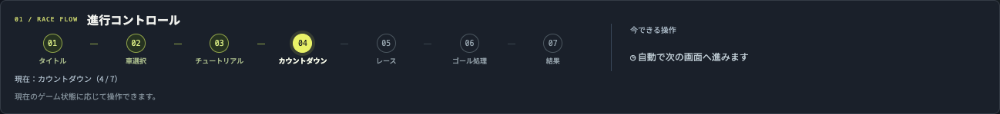
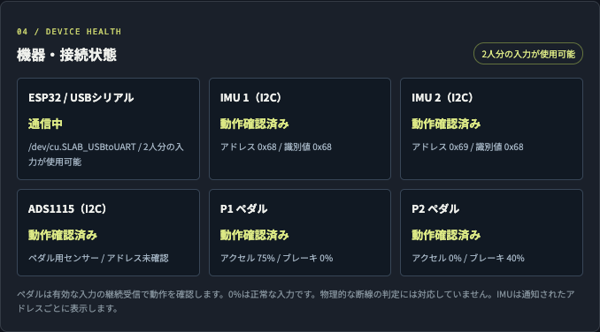

# RACING PC・Unity 操作マニュアル

対象：ゲームPCの起動、Unityでの確認、Windows版の作成、当日の復旧を行うスタッフ。**どの画面を開き、何を押し、どうなれば完了か**をまとめています。

更新：2026年10月27日／Unity **6000.3.9f1**。ブラウザー向けは [読みやすいHTML版](CustomerServiceManual.html)。図は説明用の模式図、管理画面は既存の検証画像です。画像内の時刻・値・状態は現場の値ではありません。

## 1. 最初に選ぶ操作

| やりたいこと | 開くもの | 完了の目印 |
| --- | --- | --- |
| 当日のゲーム運転 | Windows：`Builds/Windows/Race.exe`／Mac：配布された `.app` | P1・P2にタイトルが出る |
| Unityで設定・映像を確認 | Unity Hub → Racing → `Assets/Scenes/SampleScene.unity` | Editorでシーンが開く |
| ゲームと管理画面を同時に確認 | Unity上部 `Racing > Start Dashboard and Play` | Playが有効になり、管理画面が開く |
| 変更をWindowsアプリへ反映 | `Racing > Build > Windows x64` | Consoleに `WINDOWS_BUILD_PASS` |

**UnityのPlayはEditor内の試運転です。既存のRace.exe／.appは更新されません。** アプリへ変更を反映するには再ビルドし、新しい出力フォルダーを使います。

## 2. PCと周辺機器を準備する



1. PCを電源につなぎ、モニターの電源と入力（HDMI／DisplayPortなど）を確認します。
2. ESP32を**データ通信対応USBケーブル**でPCに接続します。P1・P2は1台のESP32で受信します。
3. P1・P2用の音声機器を接続します。別々の音を出す場合は、OSで別機器として認識される2系統が必要です。
4. 両ハンドルを中央、両ペダルを離した状態にします。起動・校正中はハンドルを動かしません。
5. 自動スリープを会場の運用時間に合わせ、更新や再起動は営業前に済ませます。

### Windowsの画面設定

1. **Windowsキー＋P →「拡張」**を選びます。「複製」では同じ画像が出ます。
2. デスクトップの空白を右クリック → **ディスプレイ設定 → 識別**。画面に出た番号と物理的な位置を確認します。
3. 表示された四角を実際の左右位置に合わせて配置し、「適用」を押します。
4. **2台以上の画面を接続した状態でゲームを起動**し、P1・P2の画面を確認します。ノートPC内蔵画面も1台に数えます。

Windows版のP2には追加ディスプレイが必要です。1画面しかない場合はUnityのGameビューで確認してください。OSの識別番号とUnityのDisplay番号は一致するとは限らないため、最後は実際のP1・P2表示で確認します。

### Macの画面設定

「システム設定 → ディスプレイ」で拡張表示にします。Metal版では外付け画面が2台そろうと、その2台へP1・P2を自動配置します。外付けが2台未満なら通常ウィンドウになります。Mac版は1画面でもP1・P2を別ウィンドウで確認できます。

## 3. ビルド済みゲームを起動する（当日の基本）

1. Windowsは配布フォルダーの **`Race.exe` をダブルクリック**。Macは配布された `.app` を開きます。
2. 両席にタイトルが出るまで待ちます。Windowsは必要に応じてタイトルバーをドラッグして配置します。
3. 管理画面を起動します。Editorを使わない場合は、下の手順で中継も起動します。
4. **「UNITY 接続中」**と両者の入力・音声を確認します。

Windowsは**出力フォルダー全体**を配布してください。`Race.exe` と同じ場所の `Race_Data`、`UnityPlayer.dll`、その他の生成物が必要です。exeだけをデスクトップへ移動しないでください。圧縮ファイルは展開してから起動します。

### Windowsで管理画面を起動

ゲームとは別に、このプロジェクトの `Tools/DashboardRelay` と **.NET 10 SDK** が必要です。

1. プロジェクトの `Tools/DashboardRelay` フォルダーを開きます。
2. エクスプローラーのアドレス欄へ `powershell` と入力し、Enterを押します。
3. 開いた画面へ次を入力し、Enterを押します。

```powershell
powershell -NoProfile -ExecutionPolicy Bypass -File .\run.ps1
```

4. ブラウザーが開いたら、同じPCでは **http://127.0.0.1:8766/** を使います。開かない場合はこのURLを手入力します。
5. **PowerShellのウィンドウを使用中は閉じません。** 終了時はCtrl＋Cで中継を停止します。

`Bypass` はこの起動プロセスだけに適用します。初回の依存ファイル取得にはインターネット接続が必要な場合があります。Macでは `Tools/DashboardRelay/Start Dashboard.command` を開きます。

別のPC・タブレットから操作する場合は、両端末のTailscaleを接続し、共有された `https://…ts.net/` を開きます。`127.0.0.1` はその端末自身を指すため、別端末からゲームPCには接続できません。詳細は [スタッフの接続](DashboardSharingParticipant.md)。

## 4. Unityで試運転する

### プロジェクトを開く

1. Unity Hubの「Projects／プロジェクト」で **Racing** を開きます。未登録なら「Add／追加」から `Assets`・`Packages`・`ProjectSettings` が入っているフォルダーを選びます。
2. バージョンは **6000.3.9f1** を使います。初回インポートとスクリプトのコンパイルが終わるまで待ちます。
3. Project欄の `Assets > Scenes > SampleScene` をダブルクリックします。
4. 下図で各欄の役割を確認します。画面の配置はPCやレイアウト設定で異なります。



| 場所 | 使い方 |
| --- | --- |
| Hierarchy | シーン内の物を選ぶ。入力設定は `GameManagers > GManager` |
| Inspector | 選択した物の設定。`Input Manager (Script)` と `Gmanager (Script)` を探す |
| Project | ファイル一覧。`Assets/Scenes/SampleScene.unity` を開く |
| Game | プレイヤーに見える映像。キーボード検証前にこの欄をクリック |
| Console | 赤いエラーを確認。見つからない場合は `Window > General > Console` |

### 入力モードを選ぶ（Play前）

Hierarchyの `GameManagers > GManager` をクリックし、Inspectorの **Input Manager (Script)** を確認します。

| 用途 | Is Debug Mode | Is P1 Serial P2 Keyboard Debug Mode |
| --- | --- | --- |
| 実機で2人プレイ（本番） | OFF | OFF |
| キーボードで2人分を検証 | ON | OFF |
| P1ハンドル実機＋W/Sペダル、P2キーボード | OFF | ON |

保存済みのSampleSceneは**実機入力（両方OFF）**です。実機を接続せず確認する場合はキーボード検証へ切り替えます。`P1 Steering Test` は通常入力、P2自動運転はOFFを本番の基準にします。

### 再生・停止する

1. **`Racing > Start Dashboard and Play`** を選びます。ゲームだけなら上部中央の **▶ Play** を1回押します。
2. Gameビューをクリックして、キー入力を受け付ける状態にします。
3. P2はGameビューのDisplay選択を切り替えて確認します。保存済みSampleSceneの指定は **Display 3**。変更した場合は `Gmanager (Script) > Displays > Player Two Display` の番号を使います。
4. 終了時は **Playをもう一度押す**。▶が非選択になれば停止です。

EditorのGameビューは1台の画面でもDisplayを切り替えて確認できます。Windowsアプリ実行時は、指定の画面がなければDisplay 2へ切り替えます。

**一時停止（Ⅱ）と停止（▶の解除）は別です。** Play中のInspector変更は、通常は停止すると元に戻ります。保存したい設定は停止後に変更してCtrl＋S（MacはCommand＋S）。試験後は入力設定を本番に戻して保存します。

### キーボード操作表

| 操作 | P1 | P2 |
| --- | --- | --- |
| アクセル | W | ↑ |
| ブレーキ | S | ↓ |
| 左／右 | A／D | ←／→ |
| 準備・決定用の入力 | Enter | 右Shift |
| コース復帰 | Space | ／ または右Ctrl |
| 走行中の中断メニュー | Esc（両者） | Esc（両者） |
| 入力診断表示の切替 | F8 | F8 |

開始・決定は画面の長押し案内に従います。車選択はアクセル短押しで欄を切り替え、長押しで確定。F8では診断・テスト設定も表示されるため、本番前に通常入力へ戻っているか確認します。

## 5. Windows x64アプリを作る（更新時）



### 初回に準備するもの

| 項目 | 目的 |
| --- | --- |
| Unity 6000.3.9f1 | プロジェクトと同じEditor |
| Windows Build Support (Mono) | Unity HubのInstalls → 対象バージョンの歯車 → Add modulesから追加 |
| Visual Studio／Build Toolsの「C++によるデスクトップ開発」とWindows SDK | Windows音声DLLの再作成 |
| .NET 10 SDK | 管理画面の起動。ゲームexeだけの起動には不要 |

### 推奨：Windowsでまとめて作成

1. **このプロジェクトのUnity Editorとゲームを終了**します。起動中は音声DLLがロックされる場合があります。
2. プロジェクトのルートでPowerShellを開きます。
3. 次を実行します。音声DLLを更新後、UnityがバックグラウンドでWindows版を作ります。

```powershell
powershell -NoProfile -ExecutionPolicy Bypass -File .\Tools\Build-Windows.ps1
```

4. `Build complete:` が表示されたら `Builds/Windows/Race.exe` を確認します。
5. 失敗時は表示されたエラーと `Logs/WindowsBuild.log` を読みます。成功表示が出る前の出力は配布しません。

### Unityメニューから作成

1. Unityを閉じた状態で `Native~\RaceAudio\build-windows.cmd` を実行します。Visual Studioのx64 C++環境は自動検索されます。
2. Unityでプロジェクトを開き、コンパイル完了を待ちます。
3. **`Racing > Build > Windows x64`** を選びます。保存確認が出たら、必要なシーン変更を保存します。
4. `SampleScene` を対象に、x64／Mono／.NET Framework互換で作成されます。出力は **`Builds/Windows/Race.exe`**。
5. Consoleの `WINDOWS_BUILD_PASS` を確認し、出力フォルダー全体をゲームPCへコピーします。

`File > Build Profiles` から作る場合も **Windows／x64、SampleSceneを含める**ことを確認します。古い・欠落したWindows音声DLLは事前チェックでエラーにします。DLLを更新してから再実行してください。

**確認の範囲：** コードのコンパイル確認とWindows実機での映像・USB・音声確認は別です。この更新時のMac環境にはWindowsビルドモジュールがなく、Windows exeの作成・起動は未確認です。同梱の旧DLLはWindowsで上記スクリプトを実行して更新してください。実機では次の全項目を確認します。

## 6. 起動後の動作確認（毎回）

- [ ] P1・P2のタイトルが、それぞれの画面に表示される。
- [ ] 管理画面が「UNITY 接続中」。表示だけでなく入力値が更新される。
- [ ] 入力は「P1/P2 実機（ESP32）」、P1ハンドルテストは通常入力、P2自動運転はOFF。
- [ ] 両者ともハンドルの左右で値が変わり、中央へ戻る。
- [ ] アクセル・ブレーキを踏むと対応する値が変わり、離すと戻る。
- [ ] P1・P2の出力先を選び、それぞれの音声機器から音が出る。
- [ ] スタッフで「車選択 → 練習 → レース → 結果 → タイトル」を1回通す。
- [ ] 管理画面へ切り替えてもゲーム・ESP32入力が継続する。

入力・テスト設定は再起動で起動時の設定に戻ります。アプリ再起動・USB再接続後は再確認します。

### 管理画面の見方



「進行コントロール」で現在地と押せる操作を確認します。画像はカウントダウン中なので、通常の開始ボタンは表示されていません。



「機器・接続状態」でESP32・IMU・ペダルを確認します。画像のポート名はMacの例。Windowsでは `COM3` などになります。ペダル0%だけで断線とは判断せず、踏み離しで値が変わるか確認します。

### 音声を割り当てる

管理画面の「音量・出力・デバッグ」でP1／P2の出力先を選びます。出ない場合は「出力機器を再検出」。同じ機器を重複指定できないため、入れ替え時は片方を「出力なし」にしてから変更します。Windowsの「設定 → システム → サウンド」と機器側の音量も確認します。

## 7. ゲームの進行をPCから操作する

| 場面 | 管理画面での操作・確認 |
| --- | --- |
| タイトル | ペダルを離す →「練習をはじめる」。両画面が練習へ進む |
| 車選択 | 車選択は廃止。固定車両で練習を開始する |
| 練習 | 加速・旋回・光る箱の獲得。最大35秒、説明と紹介を含めスタート操作から最大60秒でレース開始 |
| 練習を手動で終える | 必要なら「チュートリアルへ進む」→両者の練習開始を確認→「カウントダウンへ進む」 |
| 横転・引っ掛かり | 「プレイヤー入力」→対象P1／P2→「復帰」を1回 |
| 次の組へ | 結果は15秒後に退出案内へ切替。降車を案内し、次の組の前にタイトルへ戻す |
| 同じ組で再挑戦 | 管理操作の再挑戦で練習を省略。通常レースは2周・最大180秒 |

Escは走行中に両者の中断メニューを開閉します。**レース全体の一時停止ではなく、タイマーや車両の完全停止は保証しません。** 対象の「走行に戻る」「スタート位置へ」「このプレイヤーを中断」を選びます。「このプレイヤーを中断」はDNF（未完走）になります。

「レースを終了して結果を表示」は未完走者をDNFで確定します。遠隔入力は対象の「遠隔操作を開始」→操作→「遠隔操作を終了」。実機より優先されるので、試験後に必ず終了し、実機のペダルを一度離します。

## 8. 困ったとき：症状から操作を選ぶ

| 症状 | 確認・操作 | 復旧の目印 |
| --- | --- | --- |
| WindowsでP2が出ない | Win＋Pで拡張、2画面以上を接続→ゲーム再起動。指定先がなければDisplay 2へ自動切替 | 両者のタイトル |
| UnityでP2が出ない | Gameビューを `Player Two Display` の番号へ変更（保存済みは3） | P2のHUD・タイトル |
| Unityでキーが効かない | Play中か、Gameをクリックしたか、Is Debug ModeがONか確認 | W／↑で値が変わる |
| 実機が反応しない | 遠隔入力を終了。実機入力・通常入力を確認しF8／管理画面で受信を見る | 両者の踏み離しに追従 |
| WindowsでUSBが見つからない | スタートを右クリック→デバイスマネージャー→「ポート（COMとLPT）」を確認。必要なら機器に合うUSBドライバーを機器担当が導入 | COM番号が表示される |
| 違うCOMポートを選ぶ | 他のシリアルアプリを閉じる。Unity停止中にInput Managerの `ESP32 USB Serial > Port Name` へ実際の `COM番号` を指定→保存・再ビルド | 機器診断で通信中 |
| ハンドル中央でも曲がる | 両者を停止→中央へ置く→「両ハンドルの基準をゼロ調整」 | 完了表示と正常な入力 |
| 音が出ない | OSと機器のミュート、ゲーム音量、P1／P2の出力先→再検出 | 各席から音が出る |
| 古いWindows音声DLLのエラー | Unity・ゲーム終了→`build-windows.cmd`→Unity再起動・再ビルド | 古いAPIのエラー解消 |
| 管理画面が開かない | 中継用PowerShellを確認。同じPCは127.0.0.1、別端末はTailscale URL | UNITY接続中 |
| UNITY未接続 | Play／ゲーム起動を確認。Editorとアプリの同時実行を避け、使う方だけ起動 | 接続中・入力値更新 |
| 画面が固まった | Alt＋Tabで選択。UnityのⅡを確認。応答しなければ症状を記録して再起動 | 通しプレイ完了 |
| ビルド失敗・赤いConsole | 最初の赤いエラーをダブルクリックして記録。Windowsモジュール・音声DLL・保存先を確認 | WINDOWS_BUILD_PASS |

USBの挿し直し・ゼロ調整・校正は走行を止めて行います。ESP32の「送信」「受付」は完了ではありません。結果を確認し、タイムアウト時は連打せず状態を照会します。管理画面の映像は約2秒ごとの静止画なので、実際の停止・復帰は現地でも確認します。

## 9. 終了する

1. 必要な結果を確認し、遠隔入力を終了します。
2. Unityなら **Playを解除**。アプリならWindowsはP1を選んで **Alt＋F4**、Macは **Command＋Q**。P1・P2両方が閉じたことを確認します。MacではP2の閉じるボタンでも全体が終了します。
3. 手動起動した中継のPowerShell／ターミナルで **Ctrl＋C** を押します。
4. 必要なシーン変更はPlay停止後に保存。PCの「シャットダウン」を選び、終了してから片付けます。
5. 障害は「時刻・P1/P2・画面のエラー・行った操作・未解決事項」を残します。

関連資料：[Windows対応と検証](WindowsSupport.md)／[2人対戦・画面設定](TwoPlayerLocalSetup.md)／[管理画面の全機能](RaceDashboard.md)／[音声出力](PlayerAudio.md)／[ESP32通信仕様](ESP32SerialProtocol.md)
