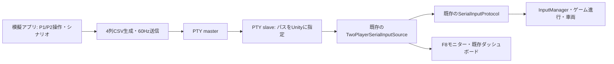

# ESP32 シリアル模擬アプリの実装計画

作成日: 2026-10-15。以下は実装前に作成した計画。

実装追記（2026-10-15）: Macアプリ・CLI・Editor接続補助・異常通信シナリオを実装。使い方と検証範囲は[ESP32Simulator.md](ESP32Simulator.md)を参照。初期検証でUnity付属Monoの`SerialPort.Open`がPTYのDTR/RTS操作で失敗したため、シミュレーター限定のPOSIX読取アダプターを追加した。以下は当初計画として残す。

## 1. 目的と採用案

ESP32を接続せず、同じMac上の別アプリから仮想シリアルポートへデータを送り、Unityの既存のシリアル受信・解析・プレイヤー別接続判定・車両操作を確認する。

初版は現在の開発環境に合わせたmacOSアプリとする。Swift / SwiftUIで操作画面を作り、Darwinの`openpty`でPTYのmaster/slaveを生成する。送信側はmasterを保持し、Unityは表示されたslaveのパスを`SerialPort`で開く。開発環境にはXcodeのSwiftツールチェーンがあることを確認済み。実行時にPython、Node.js、外部シリアルツールを要求しない構成を目指す。



`openpty`はmaster/slaveとslaveのパスを返すOSのAPIである。[Apple公式マニュアル](https://developer.apple.com/library/archive/documentation/System/Conceptual/ManPages_iPhoneOS/man3/openpty.3.html)

PTYを現在のUnityランタイムの`System.IO.Ports`で開けるかは未検証。工程1を成立条件とし、操作画面の本実装より先に確認する。

## 2. このプロジェクトで確認した条件

| 項目 | 現状・設計への反映 |
| --- | --- |
| 受信経路 | `InputManager` → `TwoPlayerSerialInputSource` → `SerialInputProtocol`。現在確認できる通信はESP32からUnityへの入力送信。Unityからの応答コマンドは不要 |
| ポート数 | 1ポートでP1/P2を同時に受信 |
| データ | `P1ペダル,P1ハンドル生値,P2ペダル,P2ハンドル生値\n`。小数点は`.` |
| 設定 | 115200 bps、ReadTimeout 200 ms、入力タイムアウト2秒。PTYでは物理UARTの転送速度は再現されない |
| 送信周期 | 仕様は30 Hz以上。アプリは60 Hzを初期値、30/60/120 Hzを選択可能にする |
| ペダル | -1〜1。正がアクセル、負がブレーキ／後退 |
| ハンドル | Unity入力 = 送信生値 ÷ Steering Divisor。クラス初期値15に対し、保存済み`SampleScene`は6.5 |
| 片軸無効 | `nan`の軸は0、他の有効な軸は更新される |
| 両軸無効 | そのプレイヤーは更新されず、最後の有効入力から2秒を超えると切断・ニュートラル。2秒までは前回状態が残り得る |
| 不正データ | 列不足・余分な列・数値以外などは行全体がINVALID。`nan,nan,nan,nan`はIGNORED |
| 自動検出 | USB/SLAB/COMのみが候補。通常のPTYは対象外なのでPort Nameの明示指定が必要 |
| 保存済み入力設定 | `isDebugMode=1`、`isP1SerialP2KeyboardDebugMode=0`。2人ともシリアルにするには両方OFF |
| タイトル | ニュートラルを0.25秒継続後、ペダル0.8以上を0.25秒継続すると各プレイヤーが開始できる |
| 選択画面 | ハンドル入力の絶対値5以上で選択、2未満へ戻すと再選択可能。±1だけを出す模擬操作では不足 |
| バックグラウンド | ProjectSettingsの`runInBackground=0`。模擬アプリ操作中のPlayerの継続動作を有効化・確認する必要がある |
| 再接続 | 送信停止からの復帰は同じポートで可能。ポートの読取スレッドが終了した後の自動再オープン処理は現状ない |

調査元: `Assets/Managers/InputManager.cs`、`Assets/Managers/Input/TwoPlayerSerialInputSource.cs`、`Assets/Managers/Input/Esp32SerialConfiguration.cs`、`Assets/Managers/Multiplayer/Core/SerialInputProtocol.cs`、`Assets/Managers/Gmanager.cs`、`Assets/Managers/UI/CarSelectionUI.cs`、`Assets/Scenes/SampleScene.unity`、`ProjectSettings/ProjectSettings.asset`、`Documentation/ESP32SerialProtocol.md`。

Unityのバックグラウンド動作は`Application.runInBackground`で制御できる。[Unity 6.3公式ドキュメント](https://docs.unity3d.com/6000.3/Documentation/ScriptReference/Application-runInBackground.html)

## 3. 初版の画面と操作

1. **接続欄**: 仮想ポートの作成・破棄、Unity用パスの表示とコピー、送信開始・一時停止、送信Hz、送信数、エラーを表示。
2. **P1/P2の操作欄**: 各ペダルのスライダー・数値入力（-1〜1）、ハンドル角度のスライダー・数値入力（初期範囲±90度）、各軸の`nan`切替を配置。
3. **倍率**: Unity側のSteering Divisorを入力（初期値6.5）。送信するハンドル生値 = 希望するUnity入力角度 × 倍率。角度と生値を併記する。例: +30度、倍率6.5なら195を送る。初版は手動でInspectorと一致させる。
4. **操作ボタン**: ニュートラル、アクセル、ブレーキ、左右へ切る、ペダル短押し／長押しをP1/P2ごとに用意。タイトル開始プリセットはニュートラル0.5秒→ペダル1を0.5秒→ニュートラルとする。
5. **送信モニター**: 実際に書き込んだCSV、送信時刻、実測送信Hzを上限付き履歴で表示。送信成功とUnity受信確認は別表示とする。UnityからACKは返らないため、書込み成功のみで「Unity接続済み」と断定しない。
6. **異常再現欄**: 送信停止、片プレイヤー無効化、片軸無効化、不正行、起動ログ、分割送信、ポート破棄を選択。実行条件をログに残す。

4列はすべて軸データであり、Reset/Readyボタン用の列はない。旧形式の`pedal,handle,reset,ready`を2人用フレームに混在させない。初版の開始・決定操作はペダル波形で再現し、リセットは現在のUnityキーボード操作を使う。シリアルからのリセットを必要とする場合は、後続の通信仕様変更として扱う。

アプリのキーボード操作はアプリが前面にあるときだけを対象とする。フォーカス喪失時には押下状態を解除し、キー入力が残らないようにする。数値設定の保持とキーの押しっぱなしは区別する。

## 4. 送信・ポート管理の設計

- PTYはraw設定でエコーと改行変換を無効化し、ASCIIのCSVとLFを送る。通常動作では必ず改行で終える。[Appleの端末設定マニュアル](https://developer.apple.com/library/archive/documentation/System/Conceptual/ManPages_iPhoneOS/man3/cfmakeraw.3.html)
- 送信はUI描画から独立した直列処理にし、単調増加時計で周期管理する。遅れた周期を大量にまとめ送りしない。短い書込み・一時的な書込み不可・相手未読の状態を処理する。
- 手動操作、シナリオ再生、異常注入のうち1つを送信状態の決定元にする。停止・切替時にシナリオの予約処理をキャンセルする。
- 通常の「ニュートラル」は`0,0,0,0\n`の継続送信。「送信停止」はポートを維持して無送信。「ポート破棄」はPTYの所有FDを閉じる。3操作を区別する。
- 起動直後やUnity未接続時のデータを無制限に蓄積しない。通常送信は開始操作を待つ。再開時は古い送信待ちデータを捨て、最新状態から送る。
- 「終了前にニュートラル送信」を通常終了処理に含めるが、強制終了や切断後の到達は保証しない。Unity側の切断・タイムアウト判定でニュートラルになることを別途確認する。
- 同じPTYを維持した無送信からの復帰と、PTY再作成後の再接続を分ける。再作成するとパスが変わり得る。初版ではUnityのPlay停止→パス再指定→Playで復帰させる。
- App Store向け配布は初版の対象外。同じMacで起動する開発用`.app`を作り、PTYアクセスが可能な構成を工程1・配布確認で検証する。

## 5. 実装工程と完了条件

| 工程 | 作業 | 完了条件 |
| --- | --- | --- |
| 1: 通信の成立確認 | 最小のSwift送信プログラムでPTY生成、固定CSVを60 Hz送信。Unityにパスを明示指定 | Unity EditorとMac Development Buildで既存`SerialPort`が開き、P1/P2の値・受信数が更新される。無送信で2秒タイムアウトし、送信再開で復帰する |
| 2: 手動操作アプリ | SwiftUI画面、4軸操作、倍率設定、送信制御、ログ、ポート破棄を実装 | ESP32なしで両者のタイトル開始・車種選択・練習・走行を手動確認できる。アプリが前面でもUnityが入力を処理する |
| 3: 異常再現・繰返し | JSON形式の時系列シナリオ、軸別`nan`、無送信、起動ログ、不正行、分割送信を実装 | 同じシナリオを繰り返し再生し、受信側の判定を確認できる。ポート破棄後は手順どおり復帰できる |
| 4: 起動の簡略化・配布 | `.app`生成手順、利用ガイド、必要ならUnity Editorの接続補助を追加 | アプリ起動→パス指定→Unity起動の手順が文書どおり成立し、10分連続送信と起動・終了10回を通過する |

工程1のPTYオープンで失敗したら、例外、Unityの実行方式、termios/ioctl対応を調べて方式を再評価する。Unity内に直接入力を注入する方式に変更する場合は、シリアルポートの検証範囲が失われることを明示する。TCP等への変更をPTY検証成功として扱わない。

候補の配置:

```text
Tools/ESP32Simulator/             Swiftアプリのソース・ビルド手順
Tools/ESP32Simulator/Scenarios/   正常・異常のJSONシナリオ
Documentation/ESP32Simulator.md 利用手順と制約
Assets/Editor/ESP32SimulatorSetupWindow.cs  接続補助が必要な場合のみ
```

工程1・2ではInspectorから設定する。接続補助を追加するなら、セッション用のポート・モード・バックグラウンド実行を適用し、終了時に復元できる設計にする。既存シーンのローカル変更を保持し、起動のたびにシーンを書き換える構成を避ける。

Standaloneでパス指定を簡略化する場合は、後続で起動引数による明示的な設定上書きを追加する。現在のプロジェクトにその機能があることは前提にしない。

## 6. 受け入れ試験

| ケース | 操作・期待結果 |
| --- | --- |
| 正常な2人入力 | `0.75,195,0.5,-97.5`、除算値6.5でP1は0.75/+30、P2は0.5/-15になる |
| 開始・選択 | 中立→開始長押し→ハンドル5度以上→中立→再操作が両者で成立。選択と走行で倍率が一致 |
| 片軸無効 | `0.75,nan,0.5,0`でP1ペダル維持、ハンドル0、PARTIAL |
| P1だけ無効 | `nan,nan,0.5,0`を2秒超継続。P1だけ切断・ニュートラル、P2は継続 |
| 全軸無効 | `nan,nan,nan,nan`継続でIGNOREDが表示され、最終有効入力から2秒超で両者切断 |
| 不正行 | 列不足・数値でない文字列を送りINVALID。後続の正常行で処理が継続し、不正行は接続時刻を更新しない |
| 起動ログ | 起動・キャリブレーション風の文字列→正常CSV。INVALIDから正常入力に移行 |
| 無送信と復帰 | 停止中はポートOpenでも2秒超で両者切断。同じポートで正常送信を再開すると復帰 |
| 分割・まとめ送信 | 1行を複数writeに分ける／複数行を1回でwrite。200 ms未満の分割間隔で正常行になることを確認。200 ms超や改行欠落では実際のReadLineのタイムアウト挙動を記録し、次の正常行で復帰可能か確認 |
| ポート破棄 | 異常終了せず切断扱いになる。現行Unityは自動再オープンしないため、Play再起動・新パス指定で復帰 |
| フォーカス | アプリを前面にしてもPlayerが更新を継続。キー操作がフォーカス喪失後に残らない |
| 継続・終了 | 10分送信、作成・終了10回で送信処理・FD・ログが増え続けない。UnityのPendingLineCountが持続的に増えない |

送信器のCSV生成・倍率計算・シナリオ時系列・短い書込み処理は単体確認する。既存`SerialInputProtocolTests`を実行し、PTY経由の試験は既存のパーサー単体試験とは別に行う。Unity受信確認はF8シリアルモニターと既存ローカルダッシュボードの値・接続状態を用いる。ダッシュボードには表示用の値のclampがあるため、角度の正確な確認はF8モニターまたは入力元の値を優先する。

自動シナリオは入力波形の再生を保証する。練習完了には実速度・進行方向の変化が必要なので、入力を流しただけでレース全体の自動完了を保証しない。状態を読んで進める自動試走は将来の追加機能とする。

## 7. 再現範囲と追加候補

初版で再現するのは、シリアルの文字列ストリーム、送信周期、起動時の非入力行、プレイヤー別の軸欠損、無送信、読み取り異常である。電気信号、実際のUSB列挙、CP2102ドライバー、DTR/RTSによるESP32再起動、センサー固有の挙動、正確なUART速度は実機試験に残る。

後続候補は、実機入力ログの記録・時刻付き再生、揺らぎとノイズ、ゲームパッド入力、Unity設定の受渡し、状態に応じた試走、Windows対応とする。Windowsの仮想COMにはmacOSのPTYとは別の仕組みが必要なため、初版からの対応は見積もりに含めない。
